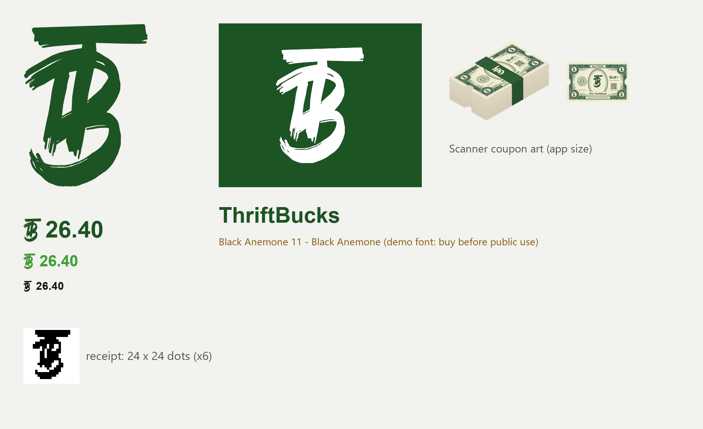

# ThriftBucks kit

**Status: in use.** The owner, 10-10, in the code chat: "ThriftBuck is the word; we are not using Rewards anymore". So there is no test switch: ThriftBucks is used everywhere (customers see nothing of Thrift+ until launch anyway). The rules are in the rulebook, `.ai/extended/thrift-plus-decisions.md` V8. The mark may still change; if it does, the kit is rebuilt with the same file names.

**When this kit changes, the code session:**
- reruns `workspace/tb_path_gen.py` (screens);
- copies `DEFINE` into `printserver/services/receipt_printer.py` (`TB_DEFINE`);
- recopies the two webps into `frontend/src/assets/thriftplus/`.

Built by the poster/art session. To rebuild, run these from the repo root:
1. `python workspace/scanner_art/tb_pack.py` (the certificate and the stack)
2. `python workspace/posters2/fontlab/build_kit.py` (everything else)

The source is the font-lab save **Black Anemone 11** (the same numbers as the first pick, "10") (`workspace/posters2/fontlab/bests.json`). If the owner picks another mark, rerun both with the new save; file names stay the same. The builder rebuilds `svg/ png/ receipt/ art/` and keeps this README.

## The symbol

| File | Use |
|---|---|
| `svg/tb-mark.svg` | **Master.** Real font outlines, `fill="currentColor"`, so it takes the text colour. Inline it (or use it as a mask) in React. |
| `svg/tb-mark-{black,forest,bright,white}.svg` | Fixed colours: black `#141614`, forest `#1d5424`, bright `#3f9f35`, white. |
| `png/tb-mark-{color}-{32..1024}.png` | Transparent PNGs, the number is the height in px. Use them in email (inline image) and anywhere SVG won't do. |

**How an amount looks:** the symbol, then the number, with no space and **no "$"**: [TB]26.40. The symbol stands about **1.3 x the digit height**, centred on the digits (like a $), in the same colour as the number. Singular: 1 ThriftBuck.

**Where only plain text works** (the text part of an email, CSV, logs, screen readers): `26.40 ThriftBucks`. The SVG has `aria-label="ThriftBucks"`.

## Receipt printer (ESC/POS, 80 mm, font A 12 x 24)

- `receipt/escpos_glyph.py`: `DEFINE` loads the mark as two user-defined characters (0x7E, 0x7F = 24 x 24 dots). Send `DEFINE` once after `ESC @`, then `ENABLE`; print `MARK` before the number; `DISABLE` before any text that needs a real `~`.
- `receipt/tb-receipt-24.png` / `-48.png`: the same mark as a raster image (24 = one text line tall, 48 = header), if a printer ignores user characters.
- `receipt/tb-glyph-2x12x24.png` / `.txt`: what the dots look like.

## The ThriftBuck certificate

Owner 10-10, final: an engraved certificate laid out like a banknote. It is **designed once** (`workspace/scanner_art/tb_cert_v3.py`, variant `final`); everything else is made from it by `workspace/scanner_art/tb_pack.py`.

- **Corners:** a **1** in each medallion.
- **Middle:** the TB alone in a tall oval cut flat at the bottom (like the dollar's portrait frame). The symbol is sized and placed for equal margins (top = bottom 130 px, the T bar 42 px clear of the curve). **"One ThriftBuck"** sits under the oval, between the leaves.
- **Top plate**, set into the border: the **Eco-Thrift** wordmark.
- **Bottom plate:** the slogan *another chance for everything & everyone*. Both plates use the logo's own lettering, cut from `eco-full-forest.png`.
- **Left:** the **Eco-Thrift seal**: a toothed ring reading "ECO-THRIFT • OMAHA, NEBRASKA", with the leaf icon engraved in hairlines.
- **Right:** **Thrift+** ("Thrift" in the money green, "+" bright green), exactly as wide as **OMAHA, NEBRASKA** under it, then a **QR** to `https://ecothrift.us/terms` (scans when framed, down to a 52 px code).
- **Captions**, where a dollar's signatures sit: **"No cash value"** and **"ecothrift.us/terms"**.
- **What the AI drew:** only the paper, the border and the empty medallions (xAI; prompt `workspace/scanner_art/prompts/T3_cert_corners.txt`, background `T3_cert_corners_2`). Every word, number, logo and the QR is exact vector or the real logo file.
- **Never on it:** a portrait, a signature, a serial number, a government seal, or the words "legal tender", "note" or "dollar".

| File | Use |
|---|---|
| `art/thriftbucks-ticket.webp` (160 px) | The scanner's single certificate (Bank it / Shower): the full certificate, QR and all. |
| `art/thriftbucks-brick.webp` (256 px) | The ThriftBucks Balance stack, 36 sheets tall, made from the same certificate: a centred band with the TB printed on it in cream, like the amount on a bank strap. |
| `art/thriftbuck-certificate.png` (1911 x 1243) | The **full certificate**, transparent: website, print, any large view. |
| `art/thriftbuck-certificate-1200.webp` | The full certificate for the web. |
| `art/thriftbucks-brick-master.png` | Large master of the stack. |

**Owner 10-10: the QR is always on the certificate. Never make a version without it.**

The webps are square with transparent space, like the old ones. The QR only works once `ecothrift.us/terms` is live.

## Fonts and licences

- **Black Anemone** (the TB): a **personal-use demo**. It must be **bought before the public sees it**. The designer is sizimon (sizimon.com; sizimon.id@gmail.com). Before buying, check that the licence covers logos and apps.
- **Nunito** (the 1s and "One ThriftBuck" on the certificate, and the scanner's money font): SIL Open Font License, free for business.
- The Thrift+ logo and wordmark are **unchanged**.
